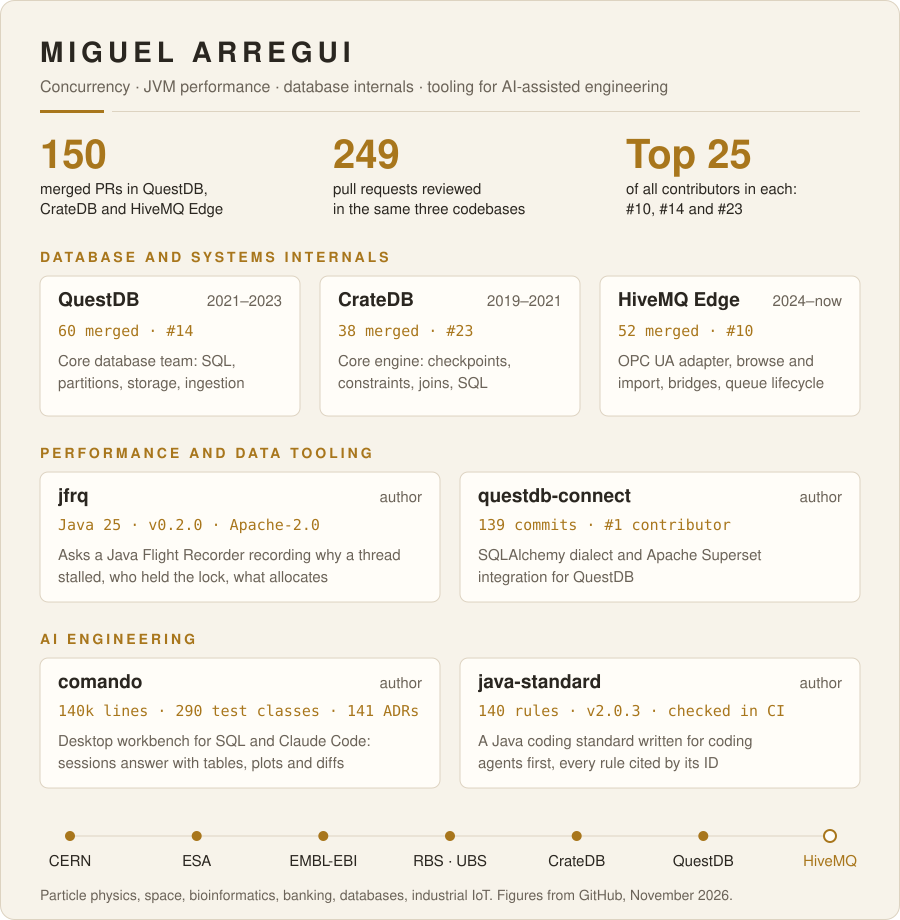

  

Senior software engineer in Castellón, Spain. I work on concurrency, JVM performance and database internals, and I build
the tooling around them: profilers that give a verdict, standards that coding agents can follow, and a workbench where
SQL and Claude Code share one window. I currently work on [HiveMQ Edge](https://github.com/hivemq/hivemq-edge), an
industrial IoT gateway that connects OPC UA and other protocols to MQTT.

## Database and systems internals

| Project | What I did | Record |
|---|---|---|
| [questdb/questdb](https://github.com/questdb/questdb) | core database team, 2021–2023: SQL, partitions, storage, ingestion (ILP) | 60 merged PRs, 14th of all contributors, 75 PRs reviewed |
| [crate/crate](https://github.com/crate/crate) | core engine, 2019–2021: SQL functions, constraints, joins, storage-engine checkpoints | 38 merged PRs, 23rd of all contributors, 40 PRs reviewed |
| [hivemq/hivemq-edge](https://github.com/hivemq/hivemq-edge) | 2024–now: OPC UA adapter, browse and import, bridge and queue lifecycle, configuration | 52 merged PRs, 10th of all contributors, 134 PRs reviewed |

<b>Selected changes</b>

| Repo | Change |
|---|---|
| QuestDB | [#3060](https://github.com/questdb/questdb/pull/3060) `SHOW PARTITIONS` and `table_partitions()` |
| QuestDB | [#2650](https://github.com/questdb/questdb/pull/2650), [#2710](https://github.com/questdb/questdb/pull/2710) attach partitions from other volumes as symbolic links, read-only |
| QuestDB | [#3975](https://github.com/questdb/questdb/pull/3975) `information_schema.columns()` |
| QuestDB | [#1251](https://github.com/questdb/questdb/pull/1251), [#1312](https://github.com/questdb/questdb/pull/1312) geohash ingestion and ILP parser edge cases |
| CrateDB | [#9309](https://github.com/crate/crate/pull/9309) advance checkpoints only after operations are persisted |
| CrateDB | [#9831](https://github.com/crate/crate/pull/9831) `CHECK` constraints |
| CrateDB | [#9046](https://github.com/crate/crate/pull/9046) overflow checks in arithmetic |
| CrateDB | [#9629](https://github.com/crate/crate/pull/9629) `JOIN ... USING` |
| HiveMQ Edge | [#1714](https://github.com/hivemq/hivemq-edge/pull/1714) periodic clean-up no longer clears live bridge and sampler queues |
| HiveMQ Edge | [#1759](https://github.com/hivemq/hivemq-edge/pull/1759) OPC UA reads and browses sized to the server's operation limits |
| HiveMQ Edge | [#1444](https://github.com/hivemq/hivemq-edge/pull/1444) bulk device tag browsing and import |

## Tools I wrote

| Project | What it is | Record |
|---|---|---|
| [marregui/jfrq](https://github.com/marregui/jfrq) | asks a Java Flight Recorder recording why a thread stalled, who held the lock, what allocates and what the JVM warned about; a verdict with its evidence, in text, HTML or JSON | Java 25, v0.2.0, Apache-2.0 |
| [questdb/questdb-connect](https://github.com/questdb/questdb-connect) | SQLAlchemy dialect and Apache Superset integration for QuestDB | 139 commits, first contributor |
| [marregui/comando](https://github.com/marregui/comando) | a desktop workbench for SQL and Claude Code: a block of text runs on the panel's database or goes to its Claude Code session, which answers with tables, plots, diffs and approval cards | 140k lines of Java 25, 290 test classes, 141 ADRs |
| [marregui/java-standard](https://github.com/marregui/java-standard) | one Java coding standard, written for coding agents (Claude, Codex) first and for the engineers who own the code; every rule has an ID, a scope and a check | 140 rules, v2.0.3, validated in CI |

## Before databases

| Period | Where | Work |
|---|---|---|
| 2000–2002 | CERN, ALICE experiment | data acquisition system; M.Sc. thesis |
| — | European Space Agency | research software |
| 2006–2013 (papers) | EMBL-EBI, Cambridge | biomedical text mining: [EBIMed](https://doi.org/10.1093/bioinformatics/btl302), [Whatizit](https://doi.org/10.1093/bioinformatics/btm557) |
| — | RBS, UBS | investment-bank infrastructure |

<b>Publications</b>

- Protein annotation by EBIMed. *Nature Biotechnology* 24(8), 2006. [doi](https://doi.org/10.1038/nbt0806-902)
- EBIMed — text crunching to gather facts for proteins from Medline. *Bioinformatics* 23(2), 2007. [doi](https://doi.org/10.1093/bioinformatics/btl302)
- Text processing through Web services: calling Whatizit. *Bioinformatics* 24(2), 2008. [doi](https://doi.org/10.1093/bioinformatics/btm557)
- PCorral — interactive mining of protein interactions from MEDLINE. *Database*, 2013. [doi](https://doi.org/10.1093/database/bat030)
- The ALICE DAQ: current status and future challenges. *Computer Physics Communications*, 2001.

[LinkedIn](https://www.linkedin.com/in/marregui)
